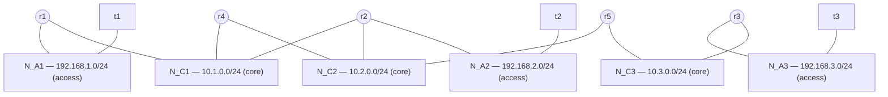
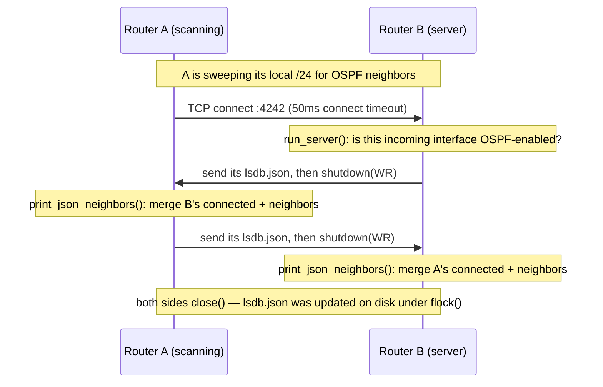

# OSPF-remake

A hop-count dynamic routing daemon written in C from scratch, running on 5 virtualized Linux routers that discover each other over TCP, exchange routing state as JSON, and program the real Linux kernel routing table — demonstrated with an automated crash/recovery scenario.


**Live demo:** https://ospf.albandavid.com

## Demo


## Table of contents

1. [Context](#context)
2. [Quick start](#quick-start)
3. [What you'll see](#what-youll-see)
4. [Network topology](#network-topology)
5. [Machine types](#machine-types)
6. [How the protocol works](#how-the-protocol-works)
7. [Comparison with real OSPF](#comparison-with-real-ospf)
8. [Technical choices & trade-offs](#technical-choices--trade-offs)
9. [Requirements coverage](#requirements-coverage)
10. [Security notes](#security-notes)
11. [CLI reference](#cli-reference)
12. [Project structure](#project-structure)
13. [Limitations & future work](#limitations--future-work)
14. [What I learned](#what-i-learned)
15. [Authors & license](#authors--license)

## Context

This project was built in my first year of a engineering school to get hands-on with dynamic routing protocols and understand OSPF's mechanics by implementing something in its spirit at a low level, instead of only reading the RFC.

- **Duration:** 6 weeks, part-time alongside coursework
- **Team:** team of 2 — Alban DAVID and Laurent Boualavong

C was chosen deliberately: POSIX sockets, `getifaddrs()` for interface discovery, and direct manipulation of the Linux kernel routing table, with nothing hiding the underlying system calls.

The brief ([`docs/specification-fr.md`](docs/specification-fr.md), [`docs/specification.pdf`](docs/specification.pdf)) asked for a routing protocol that is simpler, more robust, more secure, and lighter than real OSPF, for a local network:

- IPv4 only, no GUI, Linux-only, validated on virtualized routers.
- Priority 1: compute best paths by hop count, react to topology changes, enable/disable the protocol per interface, program the IPv4 routing table, remember and display neighbors, tolerate network failures.
- Priority 2: minimize exchanged data, memory use, and convergence time; support originating a default route.
- Priority 3: factor available bandwidth into the metric; secure the exchanges.

How much of that is actually implemented is in [Requirements coverage](#requirements-coverage) below — some of it isn't, and that's called out directly rather than implied away.

## Quick start

**Prerequisites:** Docker with Compose v2 (`docker compose version`).

```sh
git clone <this-repo>
cd OSPF-remake
docker compose up --build
```

Makefile shortcuts for the same operations:

```sh
make up      # docker compose up --build
make demo    # re-run just the scenario against an already-running lab
make logs    # follow logs from every container
make down    # stop and remove containers/networks
make clean   # full teardown: containers, networks, volumes, local images
```

What happens, minute by minute:

- **~0:00** — 5 router images and 3 terminal images build (multi-stage Dockerfile; a few seconds after the first build, since only `entrypoint.sh`/source changes invalidate the cache).
- **~0:00** — all 5 routers and 3 terminals start (plus the `scenario` container); each router's daemon starts, forks its server process, and enables its core-facing interfaces.
- **~0:05–0:40** — routers discover each other and converge (measured 4-41s across runs, depending on whether neighbors were already known from a previous run — see [measured times](#what-youll-see)).
- **~0:40** — the `scenario` container (on by default — see [the scenario service](#the-scenario-service)) prints every router's effective routing table and kernel `ip route`, then runs a ping matrix between the 3 terminals.
- **~1:00** — the scenario stops `r2` to simulate a failure, waits for reconvergence, re-checks the tables and pings (expecting `t2` to become unreachable and `t1↔t3` to keep working).
- **~1:40** — the scenario restarts `r2`, waits for full recovery, and re-runs the ping matrix.
- **End** — a PASS/FAIL summary with the three measured convergence times, and an exit code (0 if everything passed).

The scenario container then exits; the 5 routers and 3 terminals keep running so you can poke at them with `docker exec`.

## What you'll see

Real output from a run of `docker compose up --build` (only the ANSI color codes are stripped below).

Each router logs its own lifecycle, immediately (stdout is explicitly line-buffered — see [Technical choices](#technical-choices--trade-offs)):

```
r2  | [22:22:58] [r2] DAEMON START listening on TCP 4242, cycle every 5s
r2  | [22:22:58] [r2] SERVER LISTENING TCP 4242
r2  | [22:23:00] [r2] INTERFACE ENABLED eth0 10.1.0.0/255.255.255.0
r2  | [22:23:00] [r2] INTERFACE ENABLED eth1 10.2.0.0/255.255.255.0
r2  | [22:23:03] [r2] LSDB RECEIVED from r4 via eth0 (seq 5, 4 entries, 1 change)
r2  | [22:23:03] [r2] NEIGHBOR UP 10.1.0.4 on eth0
r2  | [22:23:28] [r2] ROUTE ADDED 10.3.0.0/24 via 10.1.0.1 (eth0) hop=3
r2  | [22:23:28] [r2] ROUTE ADDED 192.168.3.0/24 via 10.1.0.1 (eth0) hop=4
r2  | [22:23:28] [r2] ROUTING TABLE 6 effective routes
r2  |     Destination          Next hop         Interface  Hops
r2  |     10.1.0.0/24          -                eth0       0
r2  |     10.2.0.0/24          -                eth1       0
r2  |     192.168.2.0/24       -                eth2       0
r2  |     192.168.1.0/24       10.1.0.1         eth0       1
r2  |     10.3.0.0/24          10.1.0.1         eth0       3
r2  |     192.168.3.0/24       10.1.0.1         eth0       4
```

The scenario container narrates the test itself:

```
=== STEP 1/7 — INITIAL CONVERGENCE ===
[PASS] initial convergence (all 5 routers know all 6 networks) in 37s

=== STEP 3/7 — PING MATRIX (converged) ===
$ docker exec t1 ping -c 3 -W 1 192.168.2.10
PING 192.168.2.10 (192.168.2.10) 56(84) bytes of data.
64 bytes from 192.168.2.10: icmp_seq=1 ttl=62 time=0.122 ms
64 bytes from 192.168.2.10: icmp_seq=2 ttl=62 time=0.219 ms
64 bytes from 192.168.2.10: icmp_seq=3 ttl=62 time=0.476 ms
--- 192.168.2.10 ping statistics ---
3 packets transmitted, 3 received, 0% packet loss, time 2065ms
[PASS] t1 -> t2 reachable

=== STEP 4/7 — SIMULATING FAILURE OF r2 ===
>>> docker stop r2 <<<
r2 sits on two equal-cost paths used by t1 <-> t3 (via r2 or via r4), and
t2 is single-homed behind it — so after the crash, t1 <-> t3 must fail over
to r4, while t2 is expected to become unreachable.

=== STEP 5/7 — RECONVERGENCE AFTER FAILURE ===
[PASS] reconverged around r2's failure in 41s (no stale route via r2, all surviving networks still reachable)
[PASS] t1 -> t3 still reachable (failover via r4)
$ docker exec t1 ping -c 3 -W 1 192.168.2.10
PING 192.168.2.10 (192.168.2.10) 56(84) bytes of data.
From 10.1.0.4 icmp_seq=1 Destination Net Unreachable
From 10.1.0.4 icmp_seq=2 Destination Net Unreachable
From 10.1.0.4 icmp_seq=3 Destination Net Unreachable
--- 192.168.2.10 ping statistics ---
3 packets transmitted, 0 received, +3 errors, 100% packet loss, time 2048ms
[PASS] t1 -> t2 unreachable (EXPECTED — r2 is down)

=== STEP 6/7 — RECOVERY OF r2 ===
>>> docker start r2 <<<
[PASS] reconverged after r2's recovery in 36s

=== SUMMARY ===
  [PASS] initial convergence (all 5 routers know all 6 networks) in 37s
  [PASS] t1 -> t2 reachable
  [PASS] t1 -> t3 reachable
  [PASS] t2 -> t3 reachable
  [PASS] reconverged around r2's failure in 41s (no stale route via r2, all surviving networks still reachable)
  [PASS] t1 -> t3 still reachable (failover via r4)
  [PASS] t1 -> t2 unreachable (EXPECTED — r2 is down)
  [PASS] reconverged after r2's recovery in 36s
  [PASS] t1 -> t2 reachable again after recovery
  [PASS] t1 -> t3 reachable after recovery
  [PASS] t2 -> t3 reachable after recovery

Convergence times:
  initial convergence       : 37s
  reconvergence after crash : 41s
  reconvergence after start : 36s

ALL CHECKS PASSED (13/13)
```

**Measured convergence times** across several runs (same two-core/core-and-access topology, no artificial load): initial cold convergence 4-41s (fast when neighbors are already known from an earlier run, slower from a cold start); reconvergence after a crash 16-41s; reconvergence after recovery 35-47s. All comfortably inside the scenario's 120s timeout. Recovery is consistently the slowest phase — see [why](#how-the-protocol-works).

Note on the crash step: `t1 → t3` has two equal-cost paths (via `r2` or via `r4`). Which one is active when the scenario reaches step 4 depends on discovery timing and isn't guaranteed to be the same every run — sometimes it's already using `r4` before the crash. The two things the scenario actually guarantees are: `t2` (single-homed behind `r2`) becomes unreachable, and `t1 ↔ t3` keeps working either way.

## Network topology



| Node | Role | Static IP(s) | Networks |
|---|---|---|---|
| `r1` | Router | 192.168.1.1, 10.1.0.1 | N_A1, N_C1 |
| `r2` | Router | 10.1.0.2, 10.2.0.2, 192.168.2.1 | N_C1, N_C2, N_A2 |
| `r3` | Router | 10.3.0.3, 192.168.3.1 | N_C3, N_A3 |
| `r4` | Router | 10.1.0.4, 10.2.0.4 | N_C1, N_C2 (transit only — no access network) |
| `r5` | Router | 10.2.0.5, 10.3.0.5 | N_C2, N_C3 |
| `t1` | Terminal | 192.168.1.10 | N_A1 |
| `t2` | Terminal | 192.168.2.10 | N_A2 |
| `t3` | Terminal | 192.168.3.10 | N_A3 |

**Core networks (`N_C1`–`N_C3`, `10.x.0.0/24`)** connect routers to each other — this is where the protocol runs (`interface add` is only called on these links; see `entrypoint.sh`). **Access networks (`N_A1`–`N_A3`, `192.168.x.0/24`)** connect each terminal to exactly one router — the protocol never runs here, but the network is still advertised as directly connected by its router, which is how the terminals become reachable from the rest of the topology at all. `r2`'s own access-facing interface, for example, shows up in its `lsdb.json` with `is_Ospf: 0` — present and advertised, but not scanned.

The bridge-to-bridge topology (`r4` and `r5` both touch `N_C2`, `r2` and `r4` both touch `N_C1`) is deliberate: it gives `t1 ↔ t3` two equal-cost router-level paths, which is what the demo scenario's crash step exercises.

## Machine types

### Routers (`Dockerfile`, Alpine 3.20)

A multi-stage build: a `builder` stage installs `gcc`/`make`/`jansson-dev` and compiles `src/`; the final image only carries the compiled binaries, the runtime `jansson` library, and `iproute2`/`iputils` — no toolchain left in the image that actually runs.

Three binaries ship (`src/Makefile`):

- **`main`** — the daemon. Forks into a server process (listens on TCP 4242) and a discovery loop (the parent).
- **`interface`** — `interface add|delete <name>` CLI to enable/disable OSPF on a specific interface.
- **`show`** — `show routes|neighbors|lsdb` CLI to inspect state.

Each router container gets `cap_add: NET_ADMIN` (needed to run `ip route` — see [How the protocol works](#how-the-protocol-works)) and these `sysctls`, set declaratively by Compose before the container's own init process even runs:

- `net.ipv4.ip_forward=1` — a router has to actually forward packets between its interfaces, which the kernel doesn't do by default.
- `net.ipv4.conf.all.rp_filter=0` and `conf.default.rp_filter=0` — disable strict reverse-path filtering, which would otherwise drop packets whose source doesn't match the interface the kernel expects for that source's route (normal for a router sitting on multiple equal-cost paths).

`entrypoint.sh` reads the container's hostname (`r1` through `r5`) and calls `interface add` on that router's core-facing interfaces only — this per-router mapping is hardcoded in the script, not auto-detected, since the topology is fixed.

### Terminals (`Dockerfile.terminal`, Debian slim)

No daemon at all. Each terminal container just gets a static IP on its access network and an explicit default route to its router (set in `docker-compose.yml`'s `command:`, which needs `cap_add: NET_ADMIN` to run `ip route replace` at startup), plus `iproute2`/`ping`/`traceroute` for testing. They exist purely as test endpoints — the ping matrix and traceroute checks in the scenario all run from here.

### Docker bridges as L2 segments

Each Compose network (`N_C1`, `N_C2`, `N_C3`, `N_A1`, `N_A2`, `N_A3`) is a separate Docker bridge network, standing in for a physical switch: any container attached to the same bridge is on the same broadcast segment, and a container attached to two bridges is acting as a router between them — exactly the role `r2`, `r4`, and `r5` play. Docker also injects a default route via each bridge's gateway IP into every container on it; on a router this would let traffic silently leave through the bridge instead of taking the path the protocol computed, so `entrypoint.sh` removes it (`ip route del default`) right at startup. Terminals keep theirs, since they aren't routers.

### The `scenario` service

A `docker:27-cli` container (just the Docker CLI, no daemon) running `scenario/run.sh`. It needs the host's Docker socket mounted read-only (`/var/run/docker.sock`) to run `docker exec/stop/start` against the other containers — the "sibling containers" pattern. That's a reasonable shortcut for a local, single-host demo lab; mounting the Docker socket into a container is equivalent to giving it root on the host, so it isn't a pattern to reuse anywhere that isn't a throwaway local lab. It runs under the `demo` Compose profile, which is active by default via `.env` (`COMPOSE_PROFILES=demo`) — delete that file, or override the variable, to exclude it.

## How the protocol works



**Startup.** `main()` creates `lsdb.json` (`init_json()`: `{name, connected: [], neighbors: [], sequence: 1}`, `name` from `gethostname()`), then discovers local interfaces with `getifaddrs()` and populates `connected` — one entry per non-loopback IPv4 interface, each starting at `hop: 0`, `is_Ospf: 0`. It forks: the child becomes the TCP server, the parent runs the discovery loop every `OSPF_INTERVAL` (5s).

**Enabling interfaces.** `entrypoint.sh` calls `interface add <name>` for each core-facing interface, which flips that entry's `is_Ospf` to `1` and bumps `sequence`. Only `is_Ospf: 1` interfaces are actively scanned — but every entry in `connected`, regardless of that flag, is still advertised to neighbors (that's how a router's access network becomes reachable from elsewhere).

**Neighbor discovery.** For each OSPF-enabled interface, the daemon connects to candidate IPs on TCP port `4242`. A full sweep of the whole `/24` runs on the first cycle and then every 6th cycle; in between, it only re-contacts IPs already known to be neighbors on that interface — a deliberate optimization, since a full 254-address sweep per interface was the dominant cost in failure-detection time. On each successful connection, the server sends its `lsdb.json` first (then half-closes its write side), the client reads it fully, merges it, and replies with its own.

**Merging a peer's LSDB** (`print_json_neighbors`): every `network`/`mask` from the peer is validated (`inet_pton`, and a check that the mask is a contiguous run of 1-bits) before being trusted. The peer's own `connected` networks are learned at `hop: 1` (skipping anything we're already directly connected to); the peer's `neighbors` entries are learned at `hop: peer_hop + 1`, with three filters: discard anything at or beyond `MAX_HOPS` (15), apply split-horizon (skip a route whose `next_hop` the peer learned from *us*), and again skip anything we're directly connected to. A strictly better hop count replaces what we already had; every merge, whether or not the hop count actually improved, stamps the entry's `last_seen` and bumps `sequence` on any real change.

**Example `lsdb.json`** (excerpt, captured live from `r2` mid-run — two of its six `neighbors` entries shown; the rest are equal-cost alternatives via a different gateway):

```json
{
    "name": "r2",
    "connected": [
        { "network": "192.168.2.0", "mask": "255.255.255.0", "gateway": "eth0", "hop": 0, "is_Ospf": 0 },
        { "network": "10.1.0.0",    "mask": "255.255.255.0", "gateway": "eth1", "hop": 0, "is_Ospf": 1 },
        { "network": "10.2.0.0",    "mask": "255.255.255.0", "gateway": "eth2", "hop": 0, "is_Ospf": 1 }
    ],
    "neighbors": [
        { "name": "r1", "network": "192.168.1.0", "mask": "255.255.255.0",
          "gateway": "eth1", "hop": 1, "next_hop": "10.1.0.1", "last_seen": 1792448755 },
        { "name": "r5", "network": "10.3.0.0", "mask": "255.255.255.0",
          "gateway": "eth1", "hop": 3, "next_hop": "10.1.0.1", "last_seen": 1792448755 }
    ],
    "sequence": 12
}
```

**Best-path computation and kernel programming.** `generate_routing_table_from_file()` walks `connected` (always kept, `hop: 0`) then `neighbors`, keeping exactly one entry per network — the first one seen, replaced only by a *strictly* lower hop count. That table is both what `show routes` prints and what gets programmed: every cycle, each non-connected entry is pushed to the kernel with `ip route replace` (idempotent — see [why unconditionally](#technical-choices--trade-offs)), and anything present last cycle but gone this cycle is removed with `ip route del`. Both only fire through validated `fork`+`execvp`, never a shell.

**Failure detection and cleanup.** A neighbor is dropped from the fast-path list only after 2 consecutive failed exchange attempts — a single timeout under ordinary container scheduling jitter isn't reliable evidence of a real failure, and treating it as such caused visible route flapping in testing. Separately, any learned route not refreshed by a successful exchange within `2 × OSPF_INTERVAL` (10s) is pruned individually (`prune_stale_neighbors`) rather than the whole neighbor table being wiped every cycle — an earlier version did wipe-and-rebuild every cycle, which made a router briefly report "no neighbors at all" to anyone querying it mid-rescan and caused a reproducible, if transient, dropped route. `interface delete` is enforced on *both* directions: the server resolves which local interface an incoming connection arrived on and drops it immediately if that interface isn't OSPF-enabled.

Measured convergence times are in [What you'll see](#what-youll-see) above; recovery is the slowest phase because a router that comes back has to be rediscovered by a full sweep, which only runs every 6th cycle (~30s worst case).

## Comparison with real OSPF

Despite the name, this protocol behaves like a distance-vector protocol (closer to RIP) loosely inspired by OSPF's vocabulary, not an implementation of OSPF's actual link-state mechanism. Said plainly, because it matters for anyone judging the design:

| Aspect | Real OSPF (RFC 2328) | This project |
|---|---|---|
| Family | Link-state | Distance-vector in practice (full routing table exchanged, re-derived locally by each router) |
| Transport | IP protocol 89 directly, no TCP/UDP | TCP unicast, port 4242 |
| Neighbor discovery | Hello packets, multicast `224.0.0.5` | Active TCP connect sweep of every host in the local `/24` |
| Topology unit | Typed LSAs (Router, Network, Summary, …), flooded unchanged hop-by-hop | The entire local `lsdb.json`, re-sent and re-derived on every exchange |
| Path computation | Dijkstra SPF, over one link-state database identical across all routers in an area | Iterative hop-count relaxation — each router's table is only as good as what its neighbors currently report, not computed from one shared graph |
| Metric | Cost (typically from interface bandwidth) | Hop count only |
| Structure | Areas, DR/BDR election on broadcast segments | Flat — every router and link treated identically |
| Convergence | Event-driven flooding + incremental SPF, often sub-second | Periodic polling every `OSPF_INTERVAL`; measured 4-47s here |
| Security | Optional cryptographic authentication | None |

**Why this was a reasonable choice for a first-year project:** the goal was to understand dynamic routing and get real experience with sockets and kernel routing, not to implement RFC 2328. A full link-state design needs a flooding mechanism that propagates each LSA *unchanged* hop-by-hop (not re-derived locally), a shared database every router agrees on, and Dijkstra run locally over that shared graph — each of those is a substantially bigger undertaking than what's here. Getting hop-count distance-vector routing working correctly, with real kernel integration and a working failure/recovery story, was already the right-sized scope.

**What it would take to move toward real link-state:** separate "Hello" (liveness) and "LSA" (topology) message types instead of one combined dump; flood received LSAs to other neighbors unchanged instead of re-deriving routes from merged tables; give every router an identical copy of the database (not each router's own merged view) and compute shortest paths locally with Dijkstra; age and re-flood LSAs individually (not the whole table via one `sequence` counter per router).

## Technical choices & trade-offs

| Choice | Why | Trade-off |
|---|---|---|
| **C** | Direct access to POSIX sockets, `getifaddrs()`, and the kernel routing table; matches the brief's "C, C++, or Rust" constraint; forces understanding of what's actually happening at the syscall level | No memory/string safety net — mitigated with input validation, `fork`+`execvp` instead of string-built shell commands, fixed-size buffers, and an ASan/UBSan pass, but the risk class is real |
| **JSON (jansson) over a custom binary format** | Git history shows the project started with a binary wire format and switched (commit *"Feat: from binary to json"*): human-readable state (`cat lsdb.json`, `show lsdb`), trivial to extend (`last_seen` was added without touching a binary layout), parsing edge cases handled by a library instead of hand-rolled | Larger payloads than a packed struct — requirement 2.1 ("minimize exchanged data") is explicitly *not* met, see below |
| **TCP unicast + active subnet scanning** instead of UDP multicast Hello | Simpler to reason about and debug — a normal TCP conversation, inspectable with `tcpdump`/`nc`; no multicast group handling needed inside each container's network namespace | A full sweep is O(subnet size) connection attempts per cycle; this was the direct cause of the convergence-time problem that needed the known-neighbor fast path |
| **`fork()` into one server + one discovery-loop process** | Simple mental model: one process always listens, one always discovers; no event-loop/async machinery | The two processes only share state through a file on disk, which caused a real read-modify-write race (lost updates) that needed an explicit `flock()` to fix |
| **`lsdb.json` as shared state on disk** | Trivially inspectable (`show lsdb`, `cat`); the write-temp-then-rename pattern gives readers atomicity for free | Needed the lock above; a disk round-trip on every exchange is not memory- or CPU-cheap |
| **`ip route` via validated `fork`+`execvp`**, not `ioctl(SIOCADDRT)`/netlink | Much simpler code, and the result is directly inspectable with `ip route` | Forks a process per route change instead of one netlink socket call; depends on the `ip` binary being present (`iproute2` package) |
| **Enum-based return codes (`return.h`)** | Every function's failure mode is explicit and typed, no silent `errno` checking | A couple of codes are overloaded (e.g. `route_exists()` reuses `INTERFACE_NOT_FOUND` to mean "already exists") — a wart, left visible rather than hidden |
| **Docker + Alpine for virtualized routers** | Cheap to spin up 5 independent Linux network namespaces (each with its own real routing table) on a laptop — matches "validate with virtualized routers" directly | Not a perfect physical-network analog: Docker's own bridge-gateway default route had to be explicitly removed so it couldn't let traffic bypass the protocol |

## Requirements coverage

Against [`docs/specification-fr.md`](docs/specification-fr.md):

| # | Requirement | Status | Notes |
|---|---|---|---|
| 1.1 | Best path by hop count, link state, nominal bandwidth | ⚠️ Partial | Hop count and link up/down ✅; bandwidth is never read or used — pure hop count only |
| 1.2 | Recompute on topology change | ✅ | Periodic rediscovery loop, every `OSPF_INTERVAL` |
| 1.3 | Enable/disable the protocol on demand | ✅ | Per-interface, via `interface add` / `interface delete`; disabling every interface stops participation entirely |
| 1.4 | Specify which interfaces participate | ✅ | `interface add` / `interface delete <name>`; enforced on both outbound scanning and inbound exchanges |
| 1.5 | Update the IPv4 routing table accordingly | ✅ | `ip route replace/del` via validated `fork`+`execvp` |
| 1.6 | Remember neighbor list (IP + hostname) | ✅ | `lsdb.json.neighbors[].name` / `.next_hop` |
| 1.7 | Display neighbor list on demand | ✅ | `show neighbors` |
| 1.8 | Tolerate network failures | ✅ | Demonstrated end-to-end by the automated scenario (crash + recovery) |
| 2.1 | Minimize exchanged information | ❌ | Each exchange sends the *entire* LSDB, every cycle — no delta/incremental updates |
| 2.2 | Minimize memory use | ⚠️ Partial | Fixed, modest caps (`MAX_ROUTES=100`, `MAX_IFACE=16`) and compact JSON, but memory footprint was never a deliberate design target |
| 2.3 | Minimize convergence time | ⚠️ Partial | A real optimization was built and measured (known-neighbor fast path, 4-47s observed) — but it's still polling-based, with a convergence floor real event-driven protocols don't have |
| 2.4 | Default route origination | ❌ | Not implemented — no code path emits or installs a default route |
| 3.1 | Bandwidth-aware metric (available capacity) | ❌ | Not implemented — same gap as 1.1's bandwidth clause |
| 3.2 | Secure the exchanges | ❌ | No authentication, no encryption — see [Security notes](#security-notes) |

## Security notes

**Done:**
- Every field received from a peer (`network`, `mask`) is validated (`inet_pton`, plus a check that the mask is a contiguous run of 1-bits) before being trusted or merged into local state.
- Kernel route changes never go through a shell: `route.c` used to build a string like `"ip route replace %s via %s ..."` and call `system()` on it — a neighbor-controlled command injection vector — fixed to validate every field and run via `fork`+`execvp` with a fixed `argv`, so no value from an untrusted peer can be interpreted as shell syntax.
- A receive size cap (4 MiB) and timeouts on every socket operation bound what a slow or adversarial peer can do to a single exchange.
- An incoming connection on a non-OSPF-enabled interface is dropped before any data is exchanged with it.

**Not done** (requirement 3.2, explicitly unmet):
- No peer authentication — any host that can reach TCP/4242 on a router and speak valid JSON is treated as a legitimate neighbor.
- No encryption — `lsdb.json` content crosses the wire in cleartext.
- No defense against a neighbor advertising a false but well-formed topology — a validated IP/mask is still just whatever the peer claims; there's no verification that a network is actually reachable through them beyond "the TCP exchange with them succeeded."

## CLI reference

```sh
# Inside a router container (or via `docker exec rX ...`)
/opt/ospf/show routes      # effective routing table (one best path per network)
/opt/ospf/show neighbors   # known neighbor routers, deduplicated by next-hop
/opt/ospf/show lsdb        # raw LSDB: every learned path, including non-best equal-cost ones

/opt/ospf/interface add eth1      # enroll eth1 in the protocol
/opt/ospf/interface delete eth1   # remove it (both outbound scanning and inbound exchanges stop)
```

Useful from the host:

```sh
docker exec r1 /opt/ospf/show routes
docker exec r1 ip route
docker exec r1 cat /opt/ospf/lsdb.json

# Manual failure test
docker stop r2
docker exec r1 ip route            # watch the route via r2 disappear within a few cycles
docker exec t1 ping -c3 192.168.2.10   # fails — t2 is behind r2
docker start r2
docker exec r1 ip route            # watch it come back
```

## Project structure

```
OSPF-remake/
├── src/                      C sources
│   ├── main.c                daemon entry point: forks the server, runs the discovery loop
│   ├── lsdb.c / lsdb.h        LSDB state: load/merge/save lsdb.json, locking, staleness pruning
│   ├── exchanges.c / .h       TCP client+server: subnet scan, known-neighbor fast path, LSDB framing
│   ├── route.c / route.h      kernel routing table changes (validated fork+execvp around `ip route`)
│   ├── interface.c            `interface add|delete` CLI
│   ├── show.c                 `show routes|neighbors|lsdb` CLI
│   ├── log.c / log.h          line-buffered, timestamped event logger
│   ├── return.c / return.h    ReturnCode enum + human-readable messages
│   ├── check-service.c / .h   "is the daemon running" check used by the interface CLI
│   └── Makefile
├── Dockerfile                 multi-stage build (Alpine 3.20) for router images
├── Dockerfile.terminal         Debian slim image for terminal containers
├── entrypoint.sh               per-router interface enablement + default-route removal
├── docker-compose.yml          5 routers, 3 terminals, 6 networks, the scenario service
├── .env                        activates the "demo" Compose profile by default
├── Makefile                    up / demo / logs / down / clean
├── scenario/run.sh              automated convergence/failure/recovery demo + PASS/FAIL summary
├── docs/
│   ├── specification.pdf        original cahier des charges (French, PDF)
│   ├── specification-fr.md      same, as Markdown
│   └── recording-a-demo.md      how to record docs/demo.gif
└── dev/                         early prototype (pre-JSON, pre-Compose); kept for history, unused by the current build
```

## Limitations & future work

- **Not actually link-state** — see [Comparison with real OSPF](#comparison-with-real-ospf). The biggest single change toward the real thing would be flooding immutable LSAs instead of re-deriving tables locally.
- **No bandwidth/capacity metric, no default-route origination, no authentication or encryption** — requirements 2.4, 3.1, 3.2 are unmet; see [Requirements coverage](#requirements-coverage).
- **Full-table exchange every cycle**, not incremental — a sequence-numbered delta exchange would directly address requirement 2.1.
- **Equal-cost paths aren't stable**: the first path seen at a given hop count wins and can flip between runs or cycles depending on exchange timing — there's no real ECMP and no path dampening/hysteresis.
- **Convergence is polling-based**, not event-driven — there's an inherent floor around `OSPF_INTERVAL` (and `2× OSPF_INTERVAL` to `6× OSPF_INTERVAL` for some failure/recovery cases) that an event-driven design wouldn't have.
- **IPv4 only** — by specification, not an oversight.
- **Only tested at this fixed 5-router/3-terminal scale** — `MAX_ROUTES=100`/`MAX_IFACE=16` are untested compile-time caps, not validated limits.

## What I learned

- Hands-on POSIX sockets beyond the basics: non-blocking `connect()` with a `select()`-based timeout, `SO_RCVTIMEO`, half-closing a socket with `shutdown(SHUT_WR)` to frame a message without a length prefix.
- That "my code called `ip route`" and "the packet actually takes that path" are two different claims — `rp_filter`, `ip_forward`, and Docker's own injected default routes all had to be understood and explicitly dealt with before traffic actually followed the computed routes.
- What a read-modify-write race looks like on real disk state, not just in theory: two processes (the daemon's server and its discovery loop) sharing one JSON file without a lock lost real updates, caught live by comparing a router's `lsdb.json` against its actual kernel routing table.
- Debugging a small distributed system from the outside: `tcpdump` inside a container to find exactly where a packet got dropped, correlating logs across 5 independent processes, diffing a program's believed state against the kernel's actual one.
- That "simple" distributed protocols still have real failure modes that only show up under actual failure, not by reading the code: an over-eager liveness check caused route flapping between two valid paths; wiping shared state instead of aging it out caused a reproducible, if transient, dropped route during a live crash test.
- The difference between a protocol *inspired by* OSPF and one that meets OSPF's RFC — and that being precise about which one this is matters more than the name on the repository.

## Authors & license

**Author:** Alban DAVID (alban.david@proton.me), Laurent BOUAlAVONG
**License:** no license file is currently present in this repository.
